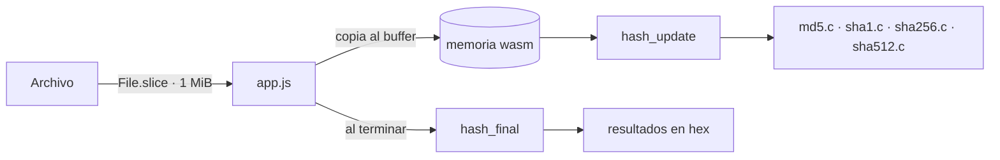

<div align="center">

# 🧮 Verificador de archivos (hash)

**Comprueba que un archivo no fue alterado: calcula su SHA-256, SHA-512, SHA-1 y MD5 en el navegador.**

Los algoritmos están escritos en **C** y compilados a **WebAssembly** sin dependencias. El archivo nunca sale de tu equipo.

[](src)
[](https://webassembly.org)
[](web/hash/app.js)
[](https://vercel.com)

🌐 **[herramientas.totalsecuritysh.com/hash](https://herramientas.totalsecuritysh.com/hash)**

</div>

## ✨ Funcionalidades

| | |
|---|---|
| 🔐 **Cuatro algoritmos a la vez** | SHA-256, SHA-512, SHA-1 y MD5 en una sola lectura del archivo. |
| 📁 **Cualquier tamaño** | Lee el archivo por bloques de 1 MiB: funciona con ISOs de varios GB sin llenar la memoria. |
| ✅ **Comparar** | Pega el hash que publica el proveedor y te dice si coincide y con qué algoritmo. |
| 📊 **Progreso** | Barra de avance por archivo. |
| 🔒 **Privacidad** | No hay servidor: el archivo se procesa en el navegador. |
| 🪶 **Ligero** | `hash.wasm` pesa ~9 KB. Sin Emscripten, sin libc, sin frameworks. |

## 🏗️ Arquitectura



```
├── src/
│   ├── hash.h          interfaz común de los algoritmos
│   ├── md5.c  sha1.c  sha256.c  sha512.c
│   ├── util.c          memset / memcpy (no hay libc en wasm)
│   └── wasm.c          funciones exportadas a JavaScript
├── tests/
│   ├── test_vectors.c  vectores oficiales (RFC 1321, FIPS 180-4)
│   └── wasm_test.mjs   compara hash.wasm contra md5sum y sha*sum
├── web/hash/           sitio estático que publica Vercel
│   ├── index.html  app.js  tool.css  brand.css
│   └── hash.wasm       binario compilado
├── Makefile
└── vercel.json
```

### Interfaz entre C y JavaScript
`wasm.c` reserva un buffer de entrada de 1 MiB y un buffer de salida. JavaScript escribe cada bloque del archivo directamente en la memoria del módulo y llama:

| Función | Uso |
|---|---|
| `buffer_ptr()` / `buffer_size()` | Dónde y cuánto escribir |
| `hash_init(mascara)` | Algoritmos a calcular: md5=1, sha1=2, sha256=4, sha512=8 |
| `hash_update(n)` | Procesa los `n` bytes del buffer |
| `hash_final()` | Escribe los resultados en `output_ptr()` |

## 🧪 Compilar y probar

Requiere `clang` y `lld` (en Ubuntu: `sudo apt install clang lld`) y Node 20+.

```bash
make test        # pruebas nativas: vectores oficiales y comparación con sha*sum
make wasm        # compila web/hash/hash.wasm
make test-wasm   # prueba el .wasm contra md5sum y sha*sum
```

Para verlo en local sirve la carpeta `web` con cualquier servidor estático:

```bash
npx serve web    # abre http://localhost:3000/hash
```

GitHub Actions ejecuta las tres pruebas en cada push.

### Multi-zones
Esta herramienta es una **zona** del hub [`tsh-herramientas`](https://github.com/TotalSecurity-SH/tsh-herramientas). Se publica en `/hash` en su propio proyecto de Vercel y el hub la sirve en `herramientas.totalsecuritysh.com/hash` mediante *rewrites*.

## ☁️ Desplegar en Vercel

1. Importa el repositorio en [vercel.com/new](https://vercel.com/new).
2. Framework: **Other**. `vercel.json` ya define la carpeta de salida (`web`) y no requiere compilación: `hash.wasm` se sube compilado.
3. **Deploy**. Queda en `https://<proyecto>.vercel.app/hash`.
4. En el proyecto del hub, define `HASH_URL` con esa URL y vuelve a desplegar el hub.

> Si cambias el código C, ejecuta `make wasm` y sube el nuevo `hash.wasm`.

## ⚠️ MD5 y SHA-1

Se incluyen porque muchos proveedores todavía los publican, pero **ya no son seguros** contra manipulación intencional. Para verificar descargas, usa SHA-256 o SHA-512.

<div align="center">

Hecho por **[Carlos Santiago](https://carlossantiago.totalsecuritysh.com)** · [Total Security SH](https://totalsecuritysh.com) · Full Stack Developer · IA y Automatización

</div>
